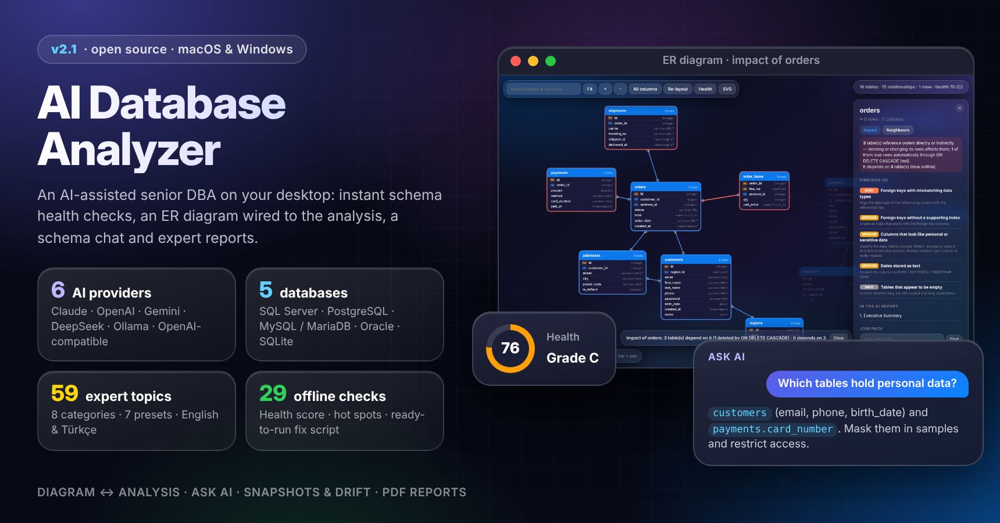
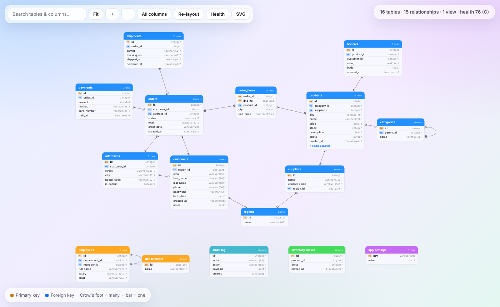
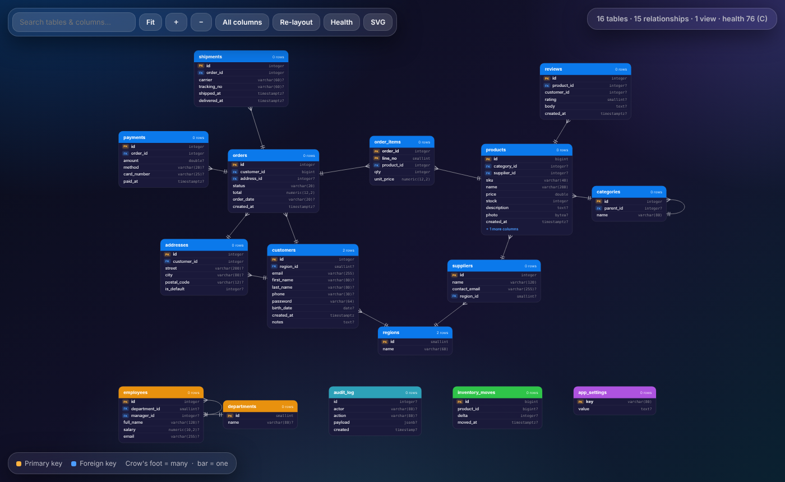
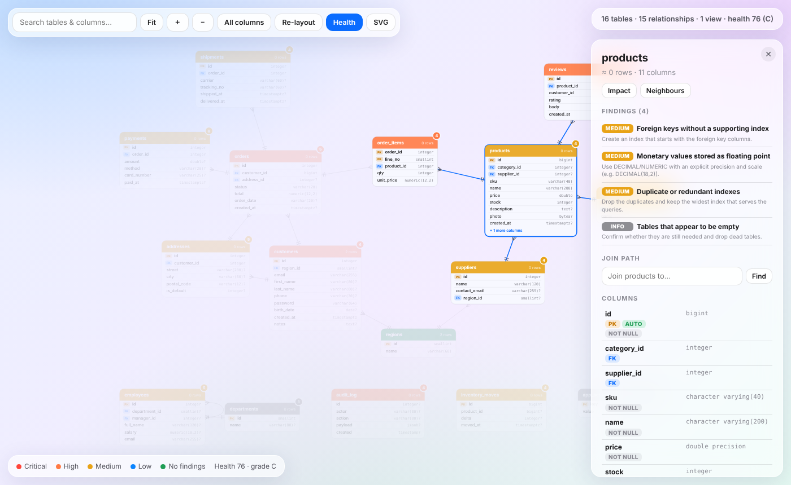
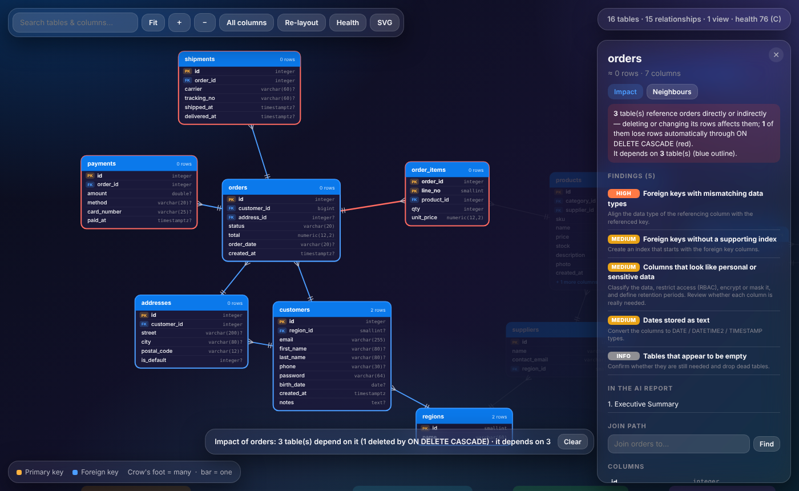
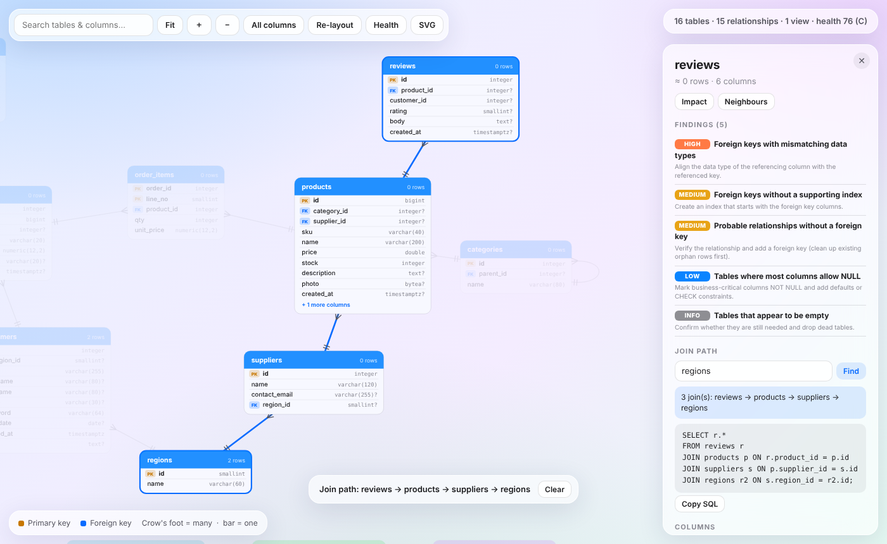
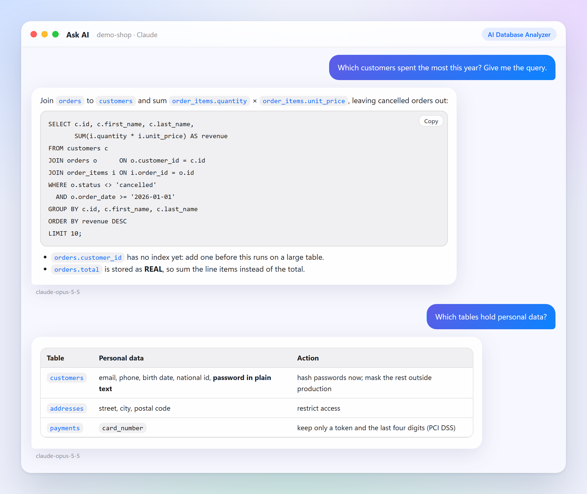
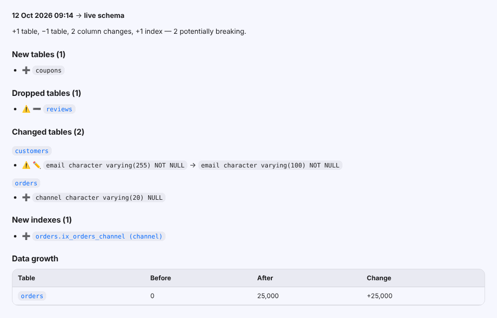

<div align="center">



<br><br>

[](https://github.com/furkiak/AIDatabaseAnalyzer/releases/latest)


[](LICENSE)


<br>


# AI Database Analyzer

**An AI-assisted senior DBA for your desktop — instant schema health checks, an interactive ER diagram that shows where the problems are, a schema chat and expert-level reports.**

**[⬇️ Download for Windows & macOS](https://github.com/furkiak/AIDatabaseAnalyzer/releases/latest)**

[English](#-english) · [Türkçe](#-türkçe)

</div>

---

<p align="center">
  
  
</p>
<p align="center"><sub>The interactive ER diagram of a sample database — drawn by the app's own dependency-free renderer, in light and dark mode.</sub></p>

<br>

# 🇺🇸 English

## What is it?

AI Database Analyzer connects to **SQL Server, PostgreSQL, MySQL / MariaDB and Oracle**, or opens a **SQLite** file, reads the *metadata* of a database (never your data, unless you ask for sample rows) and reviews it the way an experienced DBA would:

1. **Instantly and offline** — a rule engine checks 29 design, performance, security and integrity rules, computes a **0–100 health score**, ranks the **hot-spot tables** and writes a **fix script** for the mechanical problems.
2. **With AI** — 59 expert topics in 8 categories are answered by the model of your choice — **Claude, OpenAI, Gemini, DeepSeek, Ollama or any OpenAI-compatible server** — then condensed into an executive summary and a prioritised action plan. Or simply **ask questions** about the schema in a chat.
3. **Visually** — the **ER diagram is wired to the analysis**: colour tables by their findings, see the blast radius of a change, find the join path between two tables and get the SQL, jump from a report or a finding straight to the tables it is about.
4. **Over time** — every extraction is kept as a **snapshot**; the app tells you what changed since last time, flags breaking changes and charts the health score.

The interface follows a *Liquid Glass* design language: translucent glass surfaces on a soft aurora background, capsule controls, specular edges, and full light / dark / system theming.

## Highlights

| | |
|---|---|
| 🩺 **Instant Insights** | 29 offline checks — missing primary keys, unindexed foreign keys, duplicate indexes, type mismatches across relationships, plain-text passwords, PII columns, probable missing foreign keys, circular dependencies, money stored as `float`, dates stored as text, naming drift and more — rolled up into a health score, a grade and a list of **hot spots**. |
| 🧰 **Fix script** | A ready-to-run, idempotent SQL script for every foreign key without an index, plus commented-out suggestions for redundant indexes and tables without a key — in the exact dialect of your engine. No AI involved. |
| 🗺️ **Diagram ↔ analysis** | **Health lens** (tables coloured by their worst finding, with counts), **impact view** (what depends on a table, which rows an `ON DELETE CASCADE` would take with it), **neighbourhood focus**, **join path finder** that writes the `JOIN` query, per-table findings and the AI report sections that mention the table. “Show in diagram” from every finding, report and chat answer. |
| 🤖 **Six AI providers** | **Claude** (official Anthropic SDK), **OpenAI**, **Gemini**, **DeepSeek**, **Ollama** and any **OpenAI-compatible** server (LM Studio, vLLM, llama.cpp, OpenRouter, Groq, Mistral…). Each keeps its own model, address and key; pick models from the live list, test in one click. |
| 💬 **Ask AI** | A chat about your schema: “top customers by revenue?”, “which tables hold personal data?”, “how do I add this column without downtime?”. Answers link table names to the diagram and SQL blocks can be copied. Findings and diagram tables have an *Ask AI* button. |
| 🕰️ **Snapshots & drift** | Each extraction is versioned (structure only). After re-extracting you see “since last Tuesday: +2 tables, 5 column changes — 1 potentially breaking”, can compare any two versions, export the changes or let the AI review them like a migration. A chart follows the health score over time. |
| ⚡ **Fast and frugal** | The schema sits in one stable system prompt: **Claude caches it explicitly**, OpenAI / DeepSeek / Gemini / Ollama reuse the prefix — after the first topic the schema costs a fraction. Cloud runs answer **several topics in parallel**; token usage and cache hits are shown live and stored with the report. |
| 🛡️ **Privacy shield** | Sample rows are masked before they leave the database: e-mails, phone numbers, card numbers (Luhn-checked), IBANs, national ids and password columns are redacted while keeping their *shape*. A confirmation appears before anything is sent to a cloud model. |
| 📄 **Real reports** | The AI's Markdown is rendered properly — headings, tables, lists, code with copy buttons — in the app, in HTML and in a PDF with a health-score cover, severity badges and page numbers. Turkish and English output. |
| 🔐 **Secure by default** | API keys and saved passwords live in the OS keychain / credential store, keys travel in headers (never in URLs), connection strings are built with the providers' builders, SQLite files are opened read-only, and the tool only ever *reads*. |

<table>
<tr>
<td width="50%"><br><sub><b>Health lens</b> — every table coloured by its worst finding; the panel lists the findings with their fix.</sub></td>
<td width="50%"><br><sub><b>Impact</b> — dependents in red, dependencies in blue, <code>ON DELETE CASCADE</code> chains highlighted.</sub></td>
</tr>
<tr>
<td width="50%"><br><sub><b>Join path</b> — the shortest path along foreign keys, with the query ready to copy.</sub></td>
<td width="50%"><br><sub><b>Ask AI</b> — answers with linked table names and copyable SQL.</sub><br><br><br><sub><b>Snapshots</b> — what changed between two versions; breaking changes marked ⚠️.</sub></td>
</tr>
</table>

## How it works

```
 Connect ──▶ Scope ──▶ Insights ──▶ AI Analysis ──▶ Reports
 (5 engines,  (db/schema,  (health score,  (59 topics,      (viewer, PDF,
  profiles)   tables,       hot spots,      presets,         Markdown, HTML,
              what to read) fix script,     parallel, retry) links to diagram)
                            ER diagram)
                   │                 Ask AI ◀── any finding, table or snapshot diff
                   └──────────────▶ Snapshots (versions, drift, health trend)
```

1. **Connect** — pick an engine and sign in (Windows authentication on Windows), enter an Oracle service name, or browse to a SQLite file. Save connections; passwords go to the keychain.
2. **Scope** — choose the database (an Oracle *schema*), the tables and what to read: indexes, constraints, views, triggers, routines, **SQL source code** and optional **sample rows** (random for tables up to 50 k rows, the first rows for larger ones — never a full-table sort).
3. **Insights** — health score, hot spots, findings (each with *Show in diagram* and *Ask AI*), the fix script, drift since the last snapshot, the ER diagram, JSON and data-dictionary exports.
4. **AI Analysis** — start from a preset, filter by category, add your own prompts (they are remembered), choose English or Türkçe and run. Topics that need data you did not extract (sample rows, code) are marked.
5. **Reports** — every analysis is stored locally; table names in a report open the diagram. **Ask AI** and **Snapshots** are always one click away in the sidebar.

## The analysis catalogue (59 topics)

**Presets:** Quick health check · Performance tuning · Security & compliance · Design review · Developer handbook · Operations & growth · Everything

<details>
<summary><b>Performance (10)</b></summary>

Non-SARGable predicates & missing indexes · Over-indexing & overlapping indexes · Trigger-induced bottlenecks & deadlocks · Hidden complexity in views · Foreign-key index deficiency · Execution-plan simulation · **Implicit conversions on join paths** · **Write hot spots & insert contention** · Heap tables & primary keys · Table width & page fragmentation (engine-aware page sizes)

</details>

<details>
<summary><b>Design (16)</b></summary>

Bloated records & data-type wastage · Normalisation (3NF) violations · Poorly designed denormalisation · Orphan records & missing integrity · Circular dependencies · ORM anti-patterns (N+1) · Recursive-CTE misuse · Siloed schema modules · Polymorphic relationships · Data-type inconsistency · Identity-column capacity · Naming standards · Soft-delete consistency · Excessive nullability · Referential actions & cascade risk · Ready-to-run DDL fix script

</details>

<details>
<summary><b>Data quality (4) — new</b></summary>

Sample-data quality signals · Uniqueness & natural keys · Enumerations, status codes & lookup tables · Temporal data & time zones

</details>

<details>
<summary><b>Security (10)</b></summary>

Multi-tenant isolation · RBAC & least privilege · PII/PHI encryption at rest · Over-reliance on client-side controls · IDOR & predictable ids · Dynamic SQL & injection · Double spending & race conditions · Missing audit trails · Input-format bypass (data poisoning) · Stored-code quality review

</details>

<details>
<summary><b>Compliance (4) — new</b></summary>

Personal-data inventory (GDPR / KVKK) · Right-to-erasure impact · Data retention (GDPR, KVKK, HIPAA) · Payment-card data scope (PCI DSS)

</details>

<details>
<summary><b>Scalability (5)</b></summary>

Horizontal-scalability bottlenecks · Time-series storage · Platform-migration risk · Domain & microservice boundaries · Partitioning & archiving

</details>

<details>
<summary><b>Operations (4) — new</b></summary>

Index & statistics maintenance plan · Online schema-change safety · Monitoring query pack · Backup & restore by data criticality

</details>

<details>
<summary><b>Developer (6) — new</b></summary>

Data dictionary · Onboarding guide · Common query cookbook · Entity models (EF Core & TypeScript) · Realistic test-data script · REST resource design

</details>

Every answer is written for your engine's SQL dialect, refers to objects in backticks (so the app can link them) and builds on the offline findings instead of repeating them.

## Supported databases

| Engine | Also works with | Notes |
|---|---|---|
| **SQL Server** | Azure SQL Database, Managed Instance | Windows authentication on Windows; grant `VIEW DEFINITION` for source code |
| **PostgreSQL 11+** | Amazon RDS / Aurora, Azure, Cloud SQL, Supabase, Neon, CockroachDB, YugabyteDB, TimescaleDB | Extension objects and partitions are skipped |
| **MySQL / MariaDB** | Aurora MySQL, PlanetScale, TiDB, SingleStore | InnoDB assumed |
| **Oracle 12.2+** | Autonomous Database (TLS address) | Each schema is a “database”; enter the service name (e.g. `FREEPDB1`) or a full address / TNS descriptor |
| **SQLite 3** | any `.db` / `.sqlite` file | Opened **read-only**; `CHECK` constraints are read from the table SQL |

A read-only account is enough everywhere.

## Download

The [latest release](https://github.com/furkiak/AIDatabaseAnalyzer/releases/latest) has ready-to-run apps — no installer, no .NET:

| File | System | How to start |
|---|---|---|
| `AIDatabaseAnalyzer-<version>-windows-x64.zip` | Windows 10 (1809+) / 11, x64 | Extract it and run `AIDatabaseAnalyzer.exe` |
| `AIDatabaseAnalyzer-<version>-macos.zip` | macOS 12+, Apple silicon and Intel | Unzip it and move *AI Database Analyzer* to **Applications** |

The apps are not signed with a paid developer certificate, so the first launch shows a warning. On Windows, choose **More info → Run anyway**. On macOS, choose **System Settings → Privacy & Security → Open Anyway**, or run `xattr -dr com.apple.quarantine "/Applications/AI Database Analyzer.app"`.

## Getting started

**Build from source** (optional — you only need this to change the code)

* [.NET 9 SDK](https://dotnet.microsoft.com/download) and the MAUI workload: `dotnet workload install maui`
* **Windows 10 (1809) / 11**, or **macOS** with Xcode (the app runs through Mac Catalyst)

```bash
# Windows
dotnet run --project AIDatabaseAnalyzer -f net9.0-windows10.0.19041.0

# macOS
dotnet build AIDatabaseAnalyzer -f net9.0-maccatalyst -t:Run
```

Or open `AIDatabaseAnalyzer.sln` in Visual Studio / Rider and press *Run*.

**Configure the AI** on the Settings page — every provider keeps its own settings. You need a local [Ollama](https://ollama.com/download) (`ollama pull qwen2.5-coder`) or an API key for Claude, OpenAI, Gemini or DeepSeek.

| Provider | Default model | What to do |
|---|---|---|
| **Ollama** (local) | `qwen2.5-coder` | Start Ollama, press *Test connection*, pick an installed model. Raise *Context* if the schema is large (needs more RAM). |
| **Anthropic Claude** | `claude-opus-5-5` | Paste an [Anthropic API key](https://platform.claude.com/settings/keys). The schema is prompt-cached; if a security topic is declined, the API's default fallback model answers it. |
| **OpenAI** | `gpt-5-mini` | Paste an [OpenAI API key](https://platform.openai.com/api-keys) and pick a model from the live list. |
| **Google Gemini** | `gemini-3.1-flash-lite-preview` | Paste a free [AI Studio key](https://aistudio.google.com/apikey). |
| **DeepSeek** | `deepseek-chat` | Paste a [DeepSeek API key](https://platform.deepseek.com/api_keys); `deepseek-reasoner` for deeper answers. |
| **OpenAI-compatible** | — | Enter the server address (e.g. `http://localhost:1234/v1` for LM Studio, `https://openrouter.ai/api/v1`), an optional key and the model id. Private addresses count as local. |

*Topics analysed at the same time* (1–8) controls parallel requests for cloud providers; local servers always run one at a time.

## Architecture

A layered, testable MVVM design. Everything that does not need a UI lives in plain C# and is covered by unit tests.

```
AIDatabaseAnalyzer/
├─ Models/                 schema, reports, connections — plain data
├─ Services/
│  ├─ Database/            per-engine catalog queries (5 engines), extraction, compact JSON, sample masking
│  ├─ Insights/            offline rule engine + health score, fix-script builder, schema diff
│  ├─ Llm/                 provider catalogue, prompt builder, topic catalogue, parallel analysis runner
│  │  └─ Backends/         Anthropic SDK · OpenAI chat (OpenAI, DeepSeek, compatible) · Gemini · Ollama
│  ├─ History/             schema snapshots (versions without row data)
│  ├─ Markdown/            small Markdown parser + safe HTML renderer
│  ├─ Reporting/           HTML / Markdown / PDF reports, ER diagram page, chat page, schema links
│  └─ Infrastructure/      settings, secure storage, report store, file dialogs, notices, theme, WebView bridge
├─ ViewModels/             one view model per screen + a shared WorkspaceSession
├─ Views/ · Controls/      XAML screens, SegmentedControl, ScoreRing, TrendChart
├─ Resources/
│  ├─ Styles/              design tokens (Colors.xaml) and Liquid-Glass styles (Styles.xaml)
│  └─ Web/diagram.html     the ER diagram renderer (no dependencies)
└─ Platforms/              Windows · Mac Catalyst
tests/AIDatabaseAnalyzer.Tests   98 tests for the platform-independent core
```

* **Screens talk through one `WorkspaceSession`** — “show this table in the diagram”, “ask the AI about this finding” and “open this report section” are session requests, so every screen can link to every other one.
* **The web pages talk back** — the diagram, report, chat and drift pages run in a WebView and send `aida://command/argument` links (copy, open table, ask AI, open section) that the app handles.
* **Interfaces and DI everywhere** — services are registered once in `MauiProgram`; view models never touch `Application.Current`.
* **Compiled bindings** (`x:DataType` on every page) catch binding typos at build time.
* **Resilient extraction** — every optional metadata section is isolated; a permission error becomes a warning, not a crash.

## Development

```bash
dotnet test tests/AIDatabaseAnalyzer.Tests      # core logic: no MAUI workload needed, runs on any OS
```

The tests include an end-to-end extraction from a real SQLite file, the provider protocols (Claude through the SDK, OpenAI, DeepSeek, Gemini, Ollama) against a fake HTTP handler, the parallel runner, schema diffs and snapshots. GitHub Actions (`.github/workflows/ci.yml`) runs them on Linux and builds the Windows app on every push. Releases are built by `.github/workflows/release.yml` (*Actions → Release → Run workflow*) from the notes in `docs/releases/`.

## Good to know

* Row counts come from catalog statistics, so they are estimates (very fresh or never-analysed tables may show `0`); SQLite tables are counted.
* The health score is a heuristic to prioritise work — not a certification.
* AI answers can be wrong. Review SQL before running it, and always test migrations on a copy — the fix script, too.
* The built-in QuestPDF is used under its [Community licence](https://www.questpdf.com/license/); check that your organisation qualifies.

## Credits & licences

[.NET MAUI](https://github.com/dotnet/maui) · [CommunityToolkit.Mvvm](https://github.com/CommunityToolkit/dotnet) · [Anthropic .NET SDK](https://github.com/anthropics/anthropic-sdk-csharp) · [QuestPDF](https://www.questpdf.com) · [Npgsql](https://www.npgsql.org) · [MySqlConnector](https://mysqlconnector.net) · [Microsoft.Data.SqlClient](https://github.com/dotnet/SqlClient) · [Microsoft.Data.Sqlite](https://github.com/dotnet/efcore) · [Oracle ODP.NET Core](https://www.nuget.org/packages/Oracle.ManagedDataAccess.Core) · DejaVu Sans Mono (Bitstream Vera licence, bundled for PDF code blocks) · sidebar icons drawn after the [Feather](https://feathericons.com) icon set (MIT).

Released under the [MIT License](LICENSE).

---

<br>

# 🇹🇷 Türkçe

## Nedir?

AI Database Analyzer; **SQL Server, PostgreSQL, MySQL / MariaDB ve Oracle** sunucularına bağlanır ya da bir **SQLite** dosyası açar, veritabanının *metadata*'sını okur (siz örnek satır istemedikçe verilerinize dokunmaz) ve deneyimli bir DBA gibi inceler:

1. **Anında ve çevrimdışı** — kural motoru 29 tasarım, performans, güvenlik ve bütünlük kuralını denetler, **0–100 arası sağlık puanı** üretir, **sıcak nokta tablolarını** sıralar ve mekanik sorunlar için bir **düzeltme betiği** yazar.
2. **Yapay zekâ ile** — 8 kategorideki 59 uzman konu, seçtiğiniz modelle yanıtlanır — **Claude, OpenAI, Gemini, DeepSeek, Ollama veya OpenAI uyumlu herhangi bir sunucu** — ardından yönetici özeti ve öncelikli eylem planına dönüştürülür. Ya da şema hakkında **sohbette soru sorun**.
3. **Görsel olarak** — **ER diyagramı analizle bağlantılıdır**: tabloları bulgularına göre renklendirin, bir değişikliğin etki alanını görün, iki tablo arasındaki birleştirme yolunu ve SQL'ini bulun, rapordan ya da bulgudan doğrudan ilgili tablolara atlayın.
4. **Zaman içinde** — her çıkarım bir **anlık görüntü** olarak saklanır; uygulama son seferden bu yana neyin değiştiğini söyler, kırıcı değişiklikleri işaretler ve sağlık puanının grafiğini çizer.

Arayüz *Liquid Glass* tasarım diliyle hazırlandı: yumuşak bir aurora arka plan üzerinde yarı saydam cam yüzeyler, kapsül kontroller, parlak kenar vurguları ve tam açık / koyu / sistem tema desteği.

## Öne çıkanlar

| | |
|---|---|
| 🩺 **Anlık Insights** | 29 çevrimdışı kontrol — eksik birincil anahtarlar, indeksi olmayan yabancı anahtarlar, yinelenen indeksler, ilişkilerde tip uyuşmazlıkları, düz metin parolalar, kişisel veri sütunları, eksik olduğu tahmin edilen yabancı anahtarlar, döngüsel bağımlılıklar, `float` tutulan para, metin tutulan tarih, isimlendirme tutarsızlığı ve fazlası — sağlık puanı, not ve **sıcak noktalar** listesine dönüştürülür. |
| 🧰 **Düzeltme betiği** | İndeksi olmayan her yabancı anahtar için çalıştırmaya hazır, tekrar çalıştırılabilir (idempotent) SQL; gereksiz indeksler ve anahtarı olmayan tablolar için yorum satırında öneriler — motorunuzun tam lehçesinde. Yapay zekâ kullanılmaz. |
| 🗺️ **Diyagram ↔ analiz** | **Sağlık katmanı** (tablolar en ciddi bulgusunun rengiyle ve sayısıyla), **etki görünümü** (tabloya kimin bağlı olduğu, `ON DELETE CASCADE` ile hangi satırların gideceği), **komşu odaklama**, `JOIN` sorgusunu yazan **birleştirme yolu bulucu**, tablo başına bulgular ve tablodan bahseden yapay zekâ rapor bölümleri. Her bulgudan, rapordan ve sohbet cevabından “Diyagramda göster”. |
| 🤖 **Altı yapay zekâ sağlayıcısı** | **Claude** (resmi Anthropic SDK), **OpenAI**, **Gemini**, **DeepSeek**, **Ollama** ve **OpenAI uyumlu** her sunucu (LM Studio, vLLM, llama.cpp, OpenRouter, Groq, Mistral…). Her biri kendi modelini, adresini ve anahtarını saklar; modeli canlı listeden seçin, tek tıkla test edin. |
| 💬 **AI'a Sor** | Şemanız hakkında sohbet: “gelire göre en iyi müşteriler?”, “hangi tablolar kişisel veri tutuyor?”, “bu sütunu kesinti olmadan nasıl eklerim?”. Cevaplardaki tablo adları diyagrama bağlanır, SQL blokları kopyalanabilir. Bulgularda ve diyagram tablolarında *AI'a Sor* düğmesi vardır. |
| 🕰️ **Anlık görüntüler ve değişim** | Her çıkarım (yalnızca yapı) sürümlenir. Yeniden çıkarımdan sonra “geçen salıdan bu yana: +2 tablo, 5 sütun değişikliği — 1'i kırıcı olabilir” görürsünüz; iki sürümü karşılaştırabilir, değişiklikleri dışa aktarabilir veya yapay zekâya bir taşıma (migration) gibi inceletebilirsiniz. Sağlık puanı grafikle izlenir. |
| ⚡ **Hızlı ve tasarruflu** | Şema tek ve sabit bir sistem prompt'unda durur: **Claude açıkça önbelleğe alır**, OpenAI / DeepSeek / Gemini / Ollama ortak başlığı yeniden kullanır — ilk konudan sonra şemanın maliyeti çok düşer. Bulut çalıştırmaları **konuları paralel** yanıtlar; token kullanımı ve önbellek isabeti canlı gösterilir ve raporla saklanır. |
| 🛡️ **Gizlilik kalkanı** | Örnek satırlar veritabanından çıkmadan maskelenir: e-posta, telefon, kart numarası (Luhn doğrulamalı), IBAN, kimlik numarası ve parola sütunları *biçimleri korunarak* gizlenir. Bulut modele bir şey gönderilmeden önce onay istenir. |
| 📄 **Gerçek raporlar** | Yapay zekânın Markdown çıktısı doğru işlenir — başlıklar, tablolar, listeler, kopyalama düğmeli kod — uygulamada, HTML'de ve sağlık puanlı kapak, önem rozetleri ve sayfa numaralı PDF'te. Türkçe ve İngilizce çıktı. |
| 🔐 **Varsayılan olarak güvenli** | API anahtarları ve kayıtlı parolalar işletim sisteminin anahtar zincirinde tutulur, anahtarlar URL'de değil başlıkta gider, bağlantı dizeleri sağlayıcıların builder'larıyla oluşturulur, SQLite dosyaları salt okunur açılır ve araç yalnızca *okur*. |

<table>
<tr>
<td width="50%"><br><sub><b>Sağlık katmanı</b> — her tablo en ciddi bulgusunun renginde; panel bulguları ve çözümlerini listeler.</sub></td>
<td width="50%"><br><sub><b>Etki</b> — bağımlı tablolar kırmızı, bağımlılıklar mavi, <code>ON DELETE CASCADE</code> zincirleri vurgulu.</sub></td>
</tr>
<tr>
<td width="50%"><br><sub><b>Birleştirme yolu</b> — yabancı anahtarlar üzerinden en kısa yol ve kopyalanmaya hazır sorgu.</sub></td>
<td width="50%"><br><sub><b>AI'a Sor</b> — bağlantılı tablo adları ve kopyalanabilir SQL ile cevaplar.</sub><br><br><br><sub><b>Anlık görüntüler</b> — iki sürüm arasındaki farklar; kırıcı değişiklikler ⚠️ ile işaretli.</sub></td>
</tr>
</table>

## Nasıl çalışır?

```
 Bağlan ──▶ Kapsam ──▶ Insights ──▶ AI Analizi ──▶ Raporlar
 (5 motor,   (veritabanı/  (sağlık puanı,  (59 konu,         (görüntüleyici, PDF,
  profiller)  şema, tablolar, sıcak noktalar, hazır setler,     Markdown, HTML,
              ne okunacak)   düzeltme betiği, paralel, tekrar)  diyagram bağlantıları)
                             ER diyagramı)
                   │                 AI'a Sor ◀── her bulgu, tablo ya da sürüm farkı
                   └──────────────▶ Anlık görüntüler (sürümler, değişim, sağlık trendi)
```

1. **Bağlan** — motoru seçip giriş yapın (Windows'ta Windows kimlik doğrulaması), Oracle için servis adını girin ya da bir SQLite dosyası seçin. Bağlantıları kaydedin; parolalar anahtar zincirine gider.
2. **Kapsam** — veritabanını (Oracle'da *şemayı*), tabloları ve neyin okunacağını seçin: indeksler, kısıtlar, view'lar, trigger'lar, rutinler, **SQL kaynak kodu** ve isteğe bağlı **örnek satırlar** (50 bin satıra kadar rastgele, daha büyüklerde ilk satırlar — asla tüm tabloyu sıralamaz).
3. **Insights** — sağlık puanı, sıcak noktalar, bulgular (her birinde *Diyagramda göster* ve *AI'a Sor*), düzeltme betiği, son anlık görüntüden bu yana değişim, ER diyagramı, JSON ve veri sözlüğü dışa aktarımı.
4. **AI Analizi** — bir hazır setle başlayın, kategoriye göre süzün, kendi prompt'larınızı ekleyin (hatırlanır), İngilizce ya da Türkçe seçip çalıştırın. Çıkarılmamış veriye (örnek satır, kod) ihtiyaç duyan konular işaretlenir.
5. **Raporlar** — her analiz yerel olarak saklanır; rapordaki tablo adları diyagramı açar. **AI'a Sor** ve **Anlık görüntüler** kenar çubuğunda her zaman bir tık uzakta.

## Analiz kataloğu (59 konu)

**Hazır setler:** Hızlı sağlık kontrolü · Performans ayarı · Güvenlik ve uyumluluk · Tasarım incelemesi · Geliştirici el kitabı · Operasyon ve büyüme · Hepsi

<details>
<summary><b>Performans (10)</b></summary>

SARGable olmayan koşullar ve eksik indeksler · Aşırı ve çakışan indeksler · Trigger kaynaklı darboğaz ve kilitlenmeler · View katmanlarındaki gizli karmaşıklık · Yabancı anahtar indeks eksikliği · Yürütme planı simülasyonu · **Birleştirme yollarında örtük dönüşümler** · **Yazma sıcak noktaları ve ekleme çekişmesi** · Heap tablolar ve birincil anahtarlar · Tablo genişliği ve sayfa parçalanması (motora göre sayfa boyutları)

</details>

<details>
<summary><b>Tasarım (16)</b></summary>

Şişirilmiş kayıtlar ve veri tipi israfı · Normalizasyon (3NF) ihlalleri · Kötü tasarlanmış denormalizasyon · Yetim kayıtlar ve eksik bütünlük · Döngüsel bağımlılıklar · ORM anti-pattern'leri (N+1) · Recursive CTE hataları · Kopuk şema modülleri · Polimorfik ilişkiler · Veri tipi tutarsızlığı · Identity kolon kapasitesi · İsimlendirme standartları · Soft delete tutarlılığı · Aşırı nullability · Referans aksiyonları ve cascade riski · Çalıştırmaya hazır DDL düzeltme betiği

</details>

<details>
<summary><b>Veri kalitesi (4) — yeni</b></summary>

Örnek verideki kalite sinyalleri · Teklik ve doğal anahtarlar · Enum'lar, durum kodları ve lookup tabloları · Zamansal veri ve saat dilimleri

</details>

<details>
<summary><b>Güvenlik (10)</b></summary>

Çok kiracılı izolasyon · RBAC ve en az ayrıcalık · PII/PHI şifreleme eksikliği · İstemci tarafına aşırı güven · IDOR ve tahmin edilebilir id'ler · Dinamik SQL ve enjeksiyon · Çift harcama ve yarış koşulları · Eksik denetim izi · Girdi biçimi atlatma (data poisoning) · Saklı kod kalite incelemesi

</details>

<details>
<summary><b>Uyumluluk (4) — yeni</b></summary>

Kişisel veri envanteri (GDPR / KVKK) · Unutulma hakkı etki analizi · Saklama süreleri (GDPR, KVKK, HIPAA) · Ödeme kartı veri kapsamı (PCI DSS)

</details>

<details>
<summary><b>Ölçeklenebilirlik (5)</b></summary>

Yatay ölçekleme darboğazları · Zaman serisi depolama · Platform taşıma riski · İş alanı ve mikroservis sınırları · Bölümleme ve arşivleme

</details>

<details>
<summary><b>Operasyon (4) — yeni</b></summary>

İndeks ve istatistik bakım planı · Çevrimiçi şema değişikliği güvenliği · İzleme sorgu paketi · Veri kritikliğine göre yedekleme ve geri yükleme

</details>

<details>
<summary><b>Geliştirici (6) — yeni</b></summary>

Veri sözlüğü · Ekibe katılım rehberi · Sık kullanılan sorgular · Entity modelleri (EF Core ve TypeScript) · Gerçekçi test verisi betiği · REST kaynak tasarımı

</details>

Her cevap motorunuzun SQL lehçesinde yazılır, nesnelere ters tırnak içinde atıf yapar (uygulama bunları bağlayabilsin diye) ve çevrimdışı bulguları tekrarlamak yerine onların üzerine inşa eder.

## Desteklenen veritabanları

| Motor | Ayrıca çalıştığı servisler | Notlar |
|---|---|---|
| **SQL Server** | Azure SQL Database, Managed Instance | Windows'ta Windows kimlik doğrulaması; kaynak kodu için `VIEW DEFINITION` yetkisi |
| **PostgreSQL 11+** | Amazon RDS / Aurora, Azure, Cloud SQL, Supabase, Neon, CockroachDB, YugabyteDB, TimescaleDB | Eklenti nesneleri ve partition'lar atlanır |
| **MySQL / MariaDB** | Aurora MySQL, PlanetScale, TiDB, SingleStore | InnoDB varsayılır |
| **Oracle 12.2+** | Autonomous Database (TLS adresi) | Her şema bir “veritabanı”dır; servis adını (ör. `FREEPDB1`) ya da tam adresi / TNS tanımını girin |
| **SQLite 3** | her `.db` / `.sqlite` dosyası | **Salt okunur** açılır; `CHECK` kısıtları tablo SQL'inden okunur |

Her motorda salt okunur bir hesap yeterlidir.

## İndir

[Son sürümde](https://github.com/furkiak/AIDatabaseAnalyzer/releases/latest) hemen çalışan uygulamalar var — kurulum ya da .NET gerekmez:

| Dosya | Sistem | Nasıl açılır |
|---|---|---|
| `AIDatabaseAnalyzer-<sürüm>-windows-x64.zip` | Windows 10 (1809+) / 11, x64 | Zip'i çıkarıp `AIDatabaseAnalyzer.exe`'yi çalıştırın |
| `AIDatabaseAnalyzer-<sürüm>-macos.zip` | macOS 12+, Apple silicon ve Intel | Zip'i açıp *AI Database Analyzer*'ı **Uygulamalar** klasörüne taşıyın |

Uygulamalar ücretli bir geliştirici sertifikasıyla imzalanmadığı için ilk açılışta uyarı çıkar. Windows'ta **Ek bilgi → Yine de çalıştır** deyin. macOS'ta **Sistem Ayarları → Gizlilik ve Güvenlik → Yine de Aç** deyin ya da `xattr -dr com.apple.quarantine "/Applications/AI Database Analyzer.app"` komutunu çalıştırın.

## Başlarken

**Kaynaktan derleme** (isteğe bağlı — yalnızca kodu değiştirmek için gerekir)

* [.NET 9 SDK](https://dotnet.microsoft.com/download) ve MAUI iş yükü: `dotnet workload install maui`
* **Windows 10 (1809) / 11** veya Xcode kurulu **macOS** (uygulama Mac Catalyst ile çalışır)

```bash
# Windows
dotnet run --project AIDatabaseAnalyzer -f net9.0-windows10.0.19041.0

# macOS
dotnet build AIDatabaseAnalyzer -f net9.0-maccatalyst -t:Run
```

Ya da `AIDatabaseAnalyzer.sln` dosyasını Visual Studio / Rider ile açıp *Run*'a basın.

**Yapay zekâyı yapılandırın:** Ayarlar sayfasında her sağlayıcı kendi ayarlarını saklar. Yerel bir [Ollama](https://ollama.com/download) (`ollama pull qwen2.5-coder`) ya da Claude, OpenAI, Gemini veya DeepSeek API anahtarı gerekir.

| Sağlayıcı | Varsayılan model | Yapılacak |
|---|---|---|
| **Ollama** (yerel) | `qwen2.5-coder` | Ollama'yı başlatın, *Test connection*'a basın, kurulu bir model seçin. Şema büyükse *Context* değerini artırın (daha fazla RAM gerekir). |
| **Anthropic Claude** | `claude-opus-5-5` | Bir [Anthropic API anahtarı](https://platform.claude.com/settings/keys) yapıştırın. Şema prompt önbelleğine alınır; bir güvenlik konusu reddedilirse API'nin varsayılan yedek modeli yanıtlar. |
| **OpenAI** | `gpt-5-mini` | Bir [OpenAI API anahtarı](https://platform.openai.com/api-keys) yapıştırıp canlı listeden model seçin. |
| **Google Gemini** | `gemini-3.1-flash-lite-preview` | Ücretsiz bir [AI Studio anahtarı](https://aistudio.google.com/apikey) yapıştırın. |
| **DeepSeek** | `deepseek-chat` | Bir [DeepSeek API anahtarı](https://platform.deepseek.com/api_keys) yapıştırın; daha derin cevaplar için `deepseek-reasoner`. |
| **OpenAI uyumlu** | — | Sunucu adresini (ör. LM Studio için `http://localhost:1234/v1`, `https://openrouter.ai/api/v1`), isteğe bağlı anahtarı ve model kimliğini girin. Özel ağ adresleri yerel sayılır. |

*Aynı anda analiz edilen konu* sayısı (1–8) bulut sağlayıcılarında paralel istekleri belirler; yerel sunucular her zaman tek tek çalışır.

## Mimari

Katmanlı, test edilebilir bir MVVM tasarımı. Arayüz gerektirmeyen her şey düz C# olarak yazıldı ve birim testleriyle korunuyor.

```
AIDatabaseAnalyzer/
├─ Models/                 şema, rapor, bağlantı — salt veri
├─ Services/
│  ├─ Database/            motor başına katalog sorguları (5 motor), çıkarım, kompakt JSON, örnek maskeleme
│  ├─ Insights/            çevrimdışı kural motoru + sağlık puanı, düzeltme betiği, şema farkı
│  ├─ Llm/                 sağlayıcı kataloğu, prompt oluşturucu, konu kataloğu, paralel analiz yürütücü
│  │  └─ Backends/         Anthropic SDK · OpenAI chat (OpenAI, DeepSeek, uyumlu) · Gemini · Ollama
│  ├─ History/             şema anlık görüntüleri (satır verisi olmadan sürümler)
│  ├─ Markdown/            küçük Markdown ayrıştırıcı + güvenli HTML çıktısı
│  ├─ Reporting/           HTML / Markdown / PDF raporları, ER diyagram sayfası, sohbet sayfası, şema bağlantıları
│  └─ Infrastructure/      ayarlar, güvenli depolama, rapor deposu, dosya diyalogları, bildirimler, tema, WebView köprüsü
├─ ViewModels/             ekran başına bir view model + ortak WorkspaceSession
├─ Views/ · Controls/      XAML ekranlar, SegmentedControl, ScoreRing, TrendChart
├─ Resources/
│  ├─ Styles/              tasarım belirteçleri (Colors.xaml) ve Liquid-Glass stilleri (Styles.xaml)
│  └─ Web/diagram.html     ER diyagram çizicisi (bağımlılıksız)
└─ Platforms/              Windows · Mac Catalyst
tests/AIDatabaseAnalyzer.Tests   platformdan bağımsız çekirdek için 98 test
```

* **Ekranlar tek bir `WorkspaceSession` üzerinden konuşur** — “bu tabloyu diyagramda göster”, “bu bulguyu yapay zekâya sor”, “bu rapor bölümünü aç” birer oturum isteğidir; böylece her ekran diğerine bağlanabilir.
* **Web sayfaları da cevap verir** — diyagram, rapor, sohbet ve değişim sayfaları WebView'da çalışır ve uygulamanın işlediği `aida://komut/argüman` bağlantıları gönderir (kopyala, tabloyu aç, AI'a sor, bölümü aç).
* **Her yerde arayüz ve DI** — servisler `MauiProgram`'da bir kez kaydedilir; view model'ler `Application.Current`'a dokunmaz.
* **Derlenmiş binding'ler** (her sayfada `x:DataType`) binding yazım hatalarını derleme anında yakalar.
* **Dayanıklı çıkarım** — her isteğe bağlı metadata bölümü yalıtılmıştır; yetki hatası çökme değil uyarı olur.

## Geliştirme

```bash
dotnet test tests/AIDatabaseAnalyzer.Tests      # çekirdek mantık: MAUI iş yükü gerekmez, her işletim sisteminde çalışır
```

Testler gerçek bir SQLite dosyasından uçtan uca çıkarımı, sahte bir HTTP işleyicisine karşı sağlayıcı protokollerini (SDK üzerinden Claude, OpenAI, DeepSeek, Gemini, Ollama), paralel yürütücüyü, şema farklarını ve anlık görüntüleri kapsar. GitHub Actions (`.github/workflows/ci.yml`) her push'ta testleri Linux'ta çalıştırır ve Windows uygulamasını derler. Sürümler `.github/workflows/release.yml` ile (*Actions → Release → Run workflow*), `docs/releases/` içindeki notlardan oluşturulur.

## Bilmeniz gerekenler

* Satır sayıları katalog istatistiklerinden gelir, yani tahmindir (yeni ya da hiç analiz edilmemiş tablolar `0` gösterebilir); SQLite tabloları sayılır.
* Sağlık puanı işi önceliklendirmek için bir sezgiseldir — sertifika değildir.
* Yapay zekâ yanıtları yanlış olabilir. SQL'i çalıştırmadan önce inceleyin, taşımaları — düzeltme betiğini de — her zaman bir kopya üzerinde deneyin.
* PDF için kullanılan QuestPDF, [Community lisansı](https://www.questpdf.com/license/) ile kullanılır; kurumunuzun koşulları karşıladığını kontrol edin.

## Teşekkürler ve lisanslar

[.NET MAUI](https://github.com/dotnet/maui) · [CommunityToolkit.Mvvm](https://github.com/CommunityToolkit/dotnet) · [Anthropic .NET SDK](https://github.com/anthropics/anthropic-sdk-csharp) · [QuestPDF](https://www.questpdf.com) · [Npgsql](https://www.npgsql.org) · [MySqlConnector](https://mysqlconnector.net) · [Microsoft.Data.SqlClient](https://github.com/dotnet/SqlClient) · [Microsoft.Data.Sqlite](https://github.com/dotnet/efcore) · [Oracle ODP.NET Core](https://www.nuget.org/packages/Oracle.ManagedDataAccess.Core) · DejaVu Sans Mono (Bitstream Vera lisansı, PDF kod blokları için pakete dahil) · kenar çubuğu simgeleri [Feather](https://feathericons.com) simge setinden esinlenerek çizildi (MIT).

[MIT Lisansı](LICENSE) ile yayımlanmıştır.
