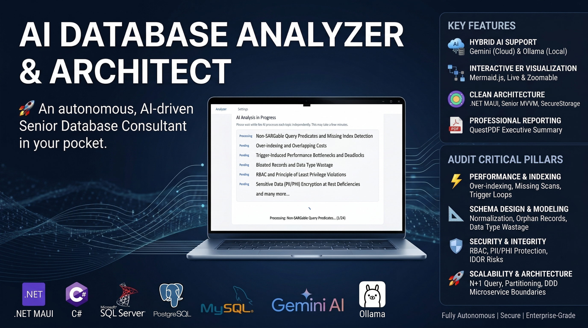

<div align="center">



<br><br>


# AI Database Analyzer

**An AI-assisted senior DBA for your desktop — instant schema health checks, an interactive ER diagram and expert-level reports.**

[English](#-english) · [Türkçe](#-türkçe)

</div>

---

<p align="center">
  
  
</p>
<p align="center"><sub>The interactive ER diagram of a sample database — drawn by the app's own dependency-free renderer, in light and dark mode.</sub></p>

<br>

# 🇺🇸 English

## What is it?

AI Database Analyzer connects to **SQL Server, PostgreSQL or MySQL / MariaDB**, reads the *metadata* of a database (never your data, unless you ask for sample rows) and then reviews it the way an experienced DBA would:

1. **Instantly and offline** — a rule engine checks 29 design, performance, security and integrity rules and computes a **0–100 health score**.
2. **With AI** — 44 expert prompts (performance, modelling, security, scalability) are answered by a **local Ollama model or Google Gemini**, then condensed into an executive summary and a prioritised action plan.
3. **As deliverables** — an in-app report viewer plus **PDF, Markdown and HTML** exports, an interactive **ER diagram** (SVG / standalone HTML) and a Markdown **data dictionary**.

The interface follows a *Liquid Glass* design language: translucent glass surfaces on a soft aurora background, capsule controls, specular edges, and full light / dark / system theming.

## Highlights

| | |
|---|---|
| 🩺 **Instant Insights** | 29 offline checks — missing primary keys, unindexed foreign keys, duplicate indexes, type mismatches across relationships, plain-text passwords, PII columns, probable missing foreign keys, circular dependencies, money stored as `float`, dates stored as text, naming drift and more — rolled up into a health score and grade. |
| 🗺️ **Interactive ER diagram** | Auto-layout with crow's-foot relationships, PK/FK badges, search, drag & zoom, click-through navigation along foreign keys, a detail panel with indexes and sample rows, **SVG export** and a **standalone HTML export**. No CDN, works offline. |
| 🤖 **Hybrid AI** | **Ollama** (everything stays on your machine) or **Gemini** (cloud). Pick models from the live list your provider returns, test the connection in one click. |
| 🛡️ **Privacy shield** | Sample rows are masked before they leave the database: e-mails, phone numbers, card numbers (Luhn-checked), IBANs, national ids and password columns are redacted while keeping their *shape*. A confirmation dialog appears before anything is sent to a cloud model. |
| ⚡ **Built for long runs** | Live progress, **cancel**, **retry only the failed topics**, automatic back-off on rate limits (`429`/`503`, honours `Retry-After`), and a partial report when you stop early. |
| 💸 **Token-smart** | Compact schema JSON (one short string per column ≈ half the tokens), the schema is sent *first* in every prompt so Gemini and Ollama can **cache the shared prefix**, and a token estimate warns you when a schema will not fit the model's context window. |
| 📄 **Real reports** | The AI's Markdown is rendered properly — headings, tables, lists, code — in the app, in HTML and in a PDF with a health-score cover, severity badges and page numbers. Turkish and English output. |
| 🔐 **Secure by default** | API key and saved passwords live in the OS keychain / credential store, the key is sent in a header (never in a URL), connection strings are built with the provider's builders (no injection through passwords), and the tool only ever *reads*. |

## How it works

```
 Connect ──▶ Scope ──▶ Insights ──▶ AI Analysis ──▶ Reports
 (profiles)  (db, tables,  (health score,  (44 topics,     (viewer, PDF,
             what to read)  findings, ER)   progress, retry) Markdown, HTML)
```

1. **Connect** — pick an engine, sign in (Windows authentication on Windows) or choose a saved connection.
2. **Scope** — choose the database, the tables and what to read: indexes, constraints, views, triggers, routines, **SQL source code** and optional **sample rows** (random for tables up to 50 k rows, the first rows for larger ones — never a full-table sort).
3. **Insights** — see the health score and findings, open the ER diagram, export the schema as JSON or as a Markdown data dictionary.
4. **AI Analysis** — filter topics by category, add your own prompts (they are remembered), choose English or Türkçe and run.
5. **Reports** — every analysis is stored locally; re-open it any time and export it.

## The analysis catalogue (44 topics)

<details>
<summary><b>Performance & indexing (10)</b></summary>

Non-SARGable predicates & missing indexes · Over-indexing & overlapping index costs · Trigger-induced bottlenecks & deadlocks · Foreign-key index deficiency · Execution-plan simulation · Collation mismatches · Connection-pool exhaustion · Heap tables & primary keys · Table width & page fragmentation · Hidden complexity in views

</details>

<details>
<summary><b>Schema design & modelling (17)</b></summary>

Bloated records & data-type wastage · Normalisation (3NF) violations · Poorly designed denormalisation · Orphan records & missing relational integrity · Circular dependencies · ORM anti-patterns (N+1) · Recursive-CTE misuse · Siloed schema modules · Polymorphic-relationship flaws · Data-type inconsistency · Identity-column capacity · Naming standards · Automated data dictionary · Soft-delete consistency · Excessive nullability · **Referential actions & cascade risk** · **Ready-to-run DDL fix script**

</details>

<details>
<summary><b>Security, privacy & integrity (12)</b></summary>

RBAC & least privilege · PII/PHI encryption at rest · Over-reliance on client-side controls · IDOR & predictable ids · Dynamic SQL & injection · Double spending & race conditions · Missing audit trails · GDPR/HIPAA retention · Input-format bypass (data poisoning) · AI model collapse in sample data · Multi-tenant isolation · **Stored-code quality review (procedures, functions, triggers, views)**

</details>

<details>
<summary><b>Scalability & architecture (5)</b></summary>

Horizontal-scalability bottlenecks · Time-series storage · Platform-migration risk · Business-domain & microservice boundaries · **Partitioning & archiving strategy**

</details>

## Getting started

**Requirements**

* [.NET 9 SDK](https://dotnet.microsoft.com/download) and the MAUI workload: `dotnet workload install maui`
* **Windows 10 (1809) / 11**, or **macOS** with Xcode (the app runs through Mac Catalyst)
* Optional: [Ollama](https://ollama.com/download) (`ollama pull qwen2.5-coder`) and/or a [Gemini API key](https://aistudio.google.com/apikey)

**Run**

```bash
# Windows
dotnet run --project AIDatabaseAnalyzer -f net9.0-windows10.0.19041.0

# macOS
dotnet build AIDatabaseAnalyzer -f net9.0-maccatalyst -t:Run
```

Or open `AIDatabaseAnalyzer.sln` in Visual Studio / Rider and press *Run*.

**Database permissions** — a read-only account is enough. On SQL Server grant `VIEW DEFINITION` if you want SQL source code in the analysis; PostgreSQL and MySQL expose definitions to users who may use the object.

**Configure the AI** (Settings page)

| Engine | What to do |
|---|---|
| **Ollama** | Start Ollama, press *Test connection*, pick an installed model. Raise *Context* if the status bar warns that the schema is too large (needs more RAM). |
| **Gemini** | Paste the API key (stored in the system keychain), press *List available models*, pick one. |

## Architecture

A layered, testable MVVM design. Everything that does not need a UI lives in plain C# and is covered by unit tests.

```
AIDatabaseAnalyzer/
├─ Models/                 schema, reports, connections — plain data
├─ Services/
│  ├─ Database/            per-engine catalog queries, extraction, compact JSON, sample masking
│  ├─ Insights/            offline rule engine + health score
│  ├─ Llm/                 Ollama/Gemini client, prompt builder, topic catalogue, analysis runner
│  ├─ Markdown/            small Markdown parser + safe HTML renderer
│  ├─ Reporting/           HTML / Markdown / PDF reports, ER diagram page builder
│  └─ Infrastructure/      settings, secure storage, history, file dialogs, notices, theme
├─ ViewModels/             one view model per screen + a shared WorkspaceSession
├─ Views/ · Controls/      XAML screens, SegmentedControl, ScoreRing
├─ Resources/
│  ├─ Styles/              design tokens (Colors.xaml) and Liquid-Glass styles (Styles.xaml)
│  └─ Web/diagram.html     the ER diagram renderer (no dependencies)
└─ Platforms/              Windows · Mac Catalyst
tests/AIDatabaseAnalyzer.Tests   38 tests for the platform-independent core
```

* **No god classes** — the former 600-line view model was split into Connect / Scope / Insights / Analysis / Reports / Diagram / Settings view models that talk through one `WorkspaceSession`.
* **Interfaces and DI everywhere** — services are registered once in `MauiProgram`; view models never touch `Application.Current`.
* **Compiled bindings** (`x:DataType` on every page) catch binding typos at build time.
* **Resilient extraction** — every optional metadata section is isolated; a permission error becomes a warning, not a crash.

## Development

```bash
dotnet test tests/AIDatabaseAnalyzer.Tests      # core logic: no MAUI workload needed, runs on any OS
```

GitHub Actions (`.github/workflows/ci.yml`) runs the tests on Linux and builds the Windows app on every push.

## Good to know

* Row counts come from catalog statistics, so they are estimates (very fresh or never-analysed tables may show `0`).
* The health score is a heuristic to prioritise work — not a certification.
* AI answers can be wrong. Review SQL before running it, and always test migrations on a copy.
* The built-in QuestPDF is used under its [Community licence](https://www.questpdf.com/license/); check that your organisation qualifies.

## Credits & licences

[.NET MAUI](https://github.com/dotnet/maui) · [CommunityToolkit.Mvvm](https://github.com/CommunityToolkit/dotnet) · [QuestPDF](https://www.questpdf.com) · [Npgsql](https://www.npgsql.org) · [MySqlConnector](https://mysqlconnector.net) · [Microsoft.Data.SqlClient](https://github.com/dotnet/SqlClient) · DejaVu Sans Mono (Bitstream Vera licence, bundled for PDF code blocks) · sidebar icons drawn after the [Feather](https://feathericons.com) icon set (MIT).

Released under the [MIT License](AIDatabaseAnalyzer/LICENSE).

---

<br>

# 🇹🇷 Türkçe

## Nedir?

AI Database Analyzer; **SQL Server, PostgreSQL veya MySQL / MariaDB** sunucusuna bağlanır, veritabanının *metadata*'sını okur (siz örnek satır istemedikçe verilerinize dokunmaz) ve deneyimli bir DBA gibi inceler:

1. **Anında ve çevrimdışı** — kural motoru 29 tasarım, performans, güvenlik ve bütünlük kuralını denetler ve **0–100 arası bir sağlık puanı** üretir.
2. **Yapay zekâ ile** — 44 uzman prompt (performans, modelleme, güvenlik, ölçeklenebilirlik) **yerel Ollama modeli veya Google Gemini** tarafından yanıtlanır; ardından yönetici özeti ve öncelikli eylem planına dönüştürülür.
3. **Çıktı olarak** — uygulama içi rapor görüntüleyici, **PDF, Markdown ve HTML** dışa aktarma, etkileşimli **ER diyagramı** (SVG / bağımsız HTML) ve Markdown **veri sözlüğü**.

Arayüz *Liquid Glass* tasarım diliyle hazırlandı: yumuşak bir aurora arka plan üzerinde yarı saydam cam yüzeyler, kapsül kontroller, parlak kenar vurguları ve tam açık / koyu / sistem tema desteği.

## Öne çıkanlar

| | |
|---|---|
| 🩺 **Anlık Insights** | 29 çevrimdışı kontrol — eksik birincil anahtarlar, indeksi olmayan yabancı anahtarlar, yinelenen indeksler, ilişkilerde tip uyuşmazlıkları, düz metin parolalar, kişisel veri sütunları, eksik olduğu tahmin edilen yabancı anahtarlar, döngüsel bağımlılıklar, `float` tutulan para, metin tutulan tarih, isimlendirme tutarsızlığı ve fazlası — sağlık puanı ve nota dönüştürülür. |
| 🗺️ **Etkileşimli ER diyagramı** | Otomatik yerleşim, “kaz ayağı” ilişki gösterimi, PK/FK rozetleri, arama, sürükle & yakınlaştır, yabancı anahtarlar üzerinden gezinme, indeks ve örnek satırları gösteren ayrıntı paneli, **SVG dışa aktarma** ve **bağımsız HTML dışa aktarma**. CDN yok, çevrimdışı çalışır. |
| 🤖 **Hibrit yapay zekâ** | **Ollama** (her şey makinenizde kalır) veya **Gemini** (bulut). Modeli sağlayıcının döndürdüğü canlı listeden seçin, bağlantıyı tek tıkla test edin. |
| 🛡️ **Gizlilik kalkanı** | Örnek satırlar veritabanından çıkmadan maskelenir: e-posta, telefon, kart numarası (Luhn doğrulamalı), IBAN, kimlik numarası ve parola sütunları *biçimleri korunarak* gizlenir. Bulut modele bir şey gönderilmeden önce onay penceresi çıkar. |
| ⚡ **Uzun işlemler için tasarlandı** | Canlı ilerleme, **iptal**, **yalnızca başarısız konuları yeniden deneme**, hız sınırlarında otomatik bekleme (`429`/`503`, `Retry-After` dikkate alınır) ve erken durdurulduğunda kısmi rapor. |
| 💸 **Token tasarrufu** | Kompakt şema JSON'u (sütun başına tek kısa metin ≈ yarı token), şema her prompt'un *başında* gönderilir — Gemini ve Ollama ortak başlığı **önbelleğe alabilir** — ve şema modelin bağlam penceresine sığmayacaksa token tahmini uyarır. |
| 📄 **Gerçek raporlar** | Yapay zekânın Markdown çıktısı doğru işlenir — başlıklar, tablolar, listeler, kod — uygulamada, HTML'de ve sağlık puanlı kapak, önem rozetleri ve sayfa numaralı PDF'te. Türkçe ve İngilizce çıktı. |
| 🔐 **Varsayılan olarak güvenli** | API anahtarı ve kayıtlı parolalar işletim sisteminin anahtar zinciri / kimlik deposunda tutulur, anahtar URL'de değil başlıkta gider, bağlantı dizeleri sağlayıcıların builder'larıyla oluşturulur (parola üzerinden enjeksiyon yok) ve araç yalnızca *okur*. |

## Nasıl çalışır?

```
 Bağlan ──▶ Kapsam ──▶ Insights ──▶ AI Analizi ──▶ Raporlar
 (profiller) (veritabanı, (sağlık puanı, (44 konu,        (görüntüleyici, PDF,
             tablolar,     bulgular, ER)   ilerleme,        Markdown, HTML)
             ne okunacak)                  yeniden dene)
```

1. **Bağlan** — motoru seçin, giriş yapın (Windows'ta Windows kimlik doğrulaması) veya kayıtlı bağlantıyı seçin.
2. **Kapsam** — veritabanını, tabloları ve neyin okunacağını seçin: indeksler, kısıtlar, view'lar, trigger'lar, rutinler, **SQL kaynak kodu** ve isteğe bağlı **örnek satırlar** (50 bin satıra kadar rastgele, daha büyük tablolarda ilk satırlar — asla tüm tabloyu sıralamaz).
3. **Insights** — sağlık puanını ve bulguları görün, ER diyagramını açın, şemayı JSON veya Markdown veri sözlüğü olarak dışa aktarın.
4. **AI Analizi** — konuları kategoriye göre süzün, kendi prompt'larınızı ekleyin (hatırlanır), İngilizce ya da Türkçe seçin ve çalıştırın.
5. **Raporlar** — her analiz yerel olarak saklanır; istediğiniz zaman yeniden açın ve dışa aktarın.

## Analiz kataloğu (44 konu)

<details>
<summary><b>Performans ve indeksleme (10)</b></summary>

SARGable olmayan sorgular ve eksik indeksler · Aşırı indeksleme ve çakışan maliyetler · Trigger kaynaklı darboğaz ve kilitlenmeler · Yabancı anahtar indeks eksikliği · Yürütme planı simülasyonu · Collation uyuşmazlıkları · Bağlantı havuzu tükenmesi · Heap tablolar ve birincil anahtarlar · Tablo genişliği ve sayfa parçalanması · View karmaşıklığı

</details>

<details>
<summary><b>Şema tasarımı ve modelleme (17)</b></summary>

Şişirilmiş kayıtlar ve veri tipi israfı · Normalizasyon (3NF) ihlalleri · Kötü tasarlanmış denormalizasyon · Yetim kayıtlar ve eksik ilişkisel bütünlük · Döngüsel bağımlılıklar · ORM anti-pattern'leri (N+1) · Recursive CTE hataları · Kopuk şema modülleri · Polimorfik ilişki hataları · Veri tipi tutarsızlığı · Identity kolon kapasitesi · İsimlendirme standartları · Otomatik veri sözlüğü · Soft delete tutarlılığı · Aşırı nullability · **Referans aksiyonları ve cascade riski** · **Çalıştırmaya hazır DDL düzeltme betiği**

</details>

<details>
<summary><b>Güvenlik, gizlilik ve bütünlük (12)</b></summary>

RBAC ve en az ayrıcalık · PII/PHI şifreleme eksikliği · İstemci tarafına aşırı güven · IDOR ve tahmin edilebilir id'ler · Dinamik SQL ve enjeksiyon · Çift harcama ve yarış koşulları · Eksik denetim izi · GDPR/HIPAA saklama süreleri · Girdi biçimi atlatma (data poisoning) · Örnek verilerde yapay zekâ kirliliği · Çok kiracılı izolasyon · **Saklı kod kalite incelemesi (prosedür, fonksiyon, trigger, view)**

</details>

<details>
<summary><b>Ölçeklenebilirlik ve mimari (5)</b></summary>

Yatay ölçekleme darboğazları · Zaman serisi depolama · Platform taşıma riski · İş alanı ve mikroservis sınırları · **Bölümleme ve arşivleme stratejisi**

</details>

## Başlarken

**Gereksinimler**

* [.NET 9 SDK](https://dotnet.microsoft.com/download) ve MAUI iş yükü: `dotnet workload install maui`
* **Windows 10 (1809) / 11** veya Xcode kurulu **macOS** (uygulama Mac Catalyst ile çalışır)
* İsteğe bağlı: [Ollama](https://ollama.com/download) (`ollama pull qwen2.5-coder`) ve/veya bir [Gemini API anahtarı](https://aistudio.google.com/apikey)

**Çalıştırma**

```bash
# Windows
dotnet run --project AIDatabaseAnalyzer -f net9.0-windows10.0.19041.0

# macOS
dotnet build AIDatabaseAnalyzer -f net9.0-maccatalyst -t:Run
```

Ya da `AIDatabaseAnalyzer.sln` dosyasını Visual Studio / Rider ile açıp *Run*'a basın.

**Veritabanı izinleri** — salt okunur bir hesap yeterlidir. SQL Server'da analize SQL kaynak kodunu dahil etmek için `VIEW DEFINITION` yetkisi verin; PostgreSQL ve MySQL tanımları nesneyi kullanabilen kullanıcılara gösterir.

**Yapay zekâyı yapılandırma** (Ayarlar sayfası)

| Motor | Yapılacak |
|---|---|
| **Ollama** | Ollama'yı başlatın, *Test connection*'a basın, kurulu bir model seçin. Şema çok büyükse *Context* değerini artırın (daha fazla RAM gerekir). |
| **Gemini** | API anahtarını yapıştırın (sistem anahtar zincirinde saklanır), *List available models*'a basıp bir model seçin. |

## Mimari

Katmanlı, test edilebilir bir MVVM tasarımı. Arayüz gerektirmeyen her şey düz C# olarak yazıldı ve birim testleriyle korunuyor.

```
AIDatabaseAnalyzer/
├─ Models/                 şema, rapor, bağlantı — salt veri
├─ Services/
│  ├─ Database/            motor başına katalog sorguları, çıkarım, kompakt JSON, örnek maskeleme
│  ├─ Insights/            çevrimdışı kural motoru + sağlık puanı
│  ├─ Llm/                 Ollama/Gemini istemcisi, prompt oluşturucu, konu kataloğu, analiz yürütücü
│  ├─ Markdown/            küçük Markdown ayrıştırıcı + güvenli HTML çıktısı
│  ├─ Reporting/           HTML / Markdown / PDF raporları, ER diyagram sayfası
│  └─ Infrastructure/      ayarlar, güvenli depolama, geçmiş, dosya diyalogları, bildirimler, tema
├─ ViewModels/             ekran başına bir view model + ortak WorkspaceSession
├─ Views/ · Controls/      XAML ekranlar, SegmentedControl, ScoreRing
├─ Resources/
│  ├─ Styles/              tasarım belirteçleri (Colors.xaml) ve Liquid-Glass stilleri (Styles.xaml)
│  └─ Web/diagram.html     ER diyagram çizicisi (bağımlılıksız)
└─ Platforms/              Windows · Mac Catalyst
tests/AIDatabaseAnalyzer.Tests   platformdan bağımsız çekirdek için 38 test
```

* **Tanrı sınıf yok** — eski 600 satırlık view model; Bağlan / Kapsam / Insights / Analiz / Raporlar / Diyagram / Ayarlar view model'lerine bölündü ve tek bir `WorkspaceSession` üzerinden haberleşiyor.
* **Her yerde arayüz ve DI** — servisler `MauiProgram`'da bir kez kaydedilir; view model'ler `Application.Current`'a dokunmaz.
* **Derlenmiş binding'ler** (her sayfada `x:DataType`) binding yazım hatalarını derleme anında yakalar.
* **Dayanıklı çıkarım** — her isteğe bağlı metadata bölümü yalıtılmıştır; yetki hatası çökme değil uyarı olur.

## Geliştirme

```bash
dotnet test tests/AIDatabaseAnalyzer.Tests      # çekirdek mantık: MAUI iş yükü gerekmez, her işletim sisteminde çalışır
```

GitHub Actions (`.github/workflows/ci.yml`) her push'ta testleri Linux'ta çalıştırır ve Windows uygulamasını derler.

## Bilmeniz gerekenler

* Satır sayıları katalog istatistiklerinden gelir, yani tahmindir (yeni ya da hiç analiz edilmemiş tablolar `0` gösterebilir).
* Sağlık puanı işi önceliklendirmek için bir sezgiseldir — sertifika değildir.
* Yapay zekâ yanıtları yanlış olabilir. SQL'i çalıştırmadan önce inceleyin, taşımaları her zaman bir kopya üzerinde deneyin.
* PDF için kullanılan QuestPDF, [Community lisansı](https://www.questpdf.com/license/) ile kullanılır; kurumunuzun koşulları karşıladığını kontrol edin.

## Teşekkürler ve lisanslar

[.NET MAUI](https://github.com/dotnet/maui) · [CommunityToolkit.Mvvm](https://github.com/CommunityToolkit/dotnet) · [QuestPDF](https://www.questpdf.com) · [Npgsql](https://www.npgsql.org) · [MySqlConnector](https://mysqlconnector.net) · [Microsoft.Data.SqlClient](https://github.com/dotnet/SqlClient) · DejaVu Sans Mono (Bitstream Vera lisansı, PDF kod blokları için pakete dahil) · kenar çubuğu simgeleri [Feather](https://feathericons.com) simge setinden esinlenerek çizildi (MIT).

[MIT Lisansı](AIDatabaseAnalyzer/LICENSE) ile yayımlanmıştır.
