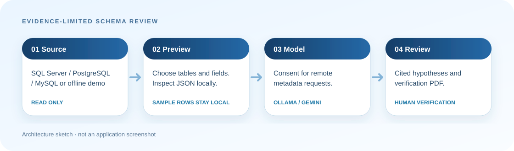

# AI Database Analyzer

An evidence-limited, AI-assisted review of database **schema metadata**. Connect to SQL Server, PostgreSQL or MySQL, select tables and metadata components, inspect the JSON locally, then ask a configured Ollama or Gemini model for hypotheses and verification questions. The app can also draw an offline relationship map and export either a model-assisted review or a **local Evidence PDF** without calling a model. Try the packaged synthetic demo before connecting to a database.

> The generated report is a starting point for a DBA review. This app does not collect execution plans, real query workloads, permissions, row counts, view/trigger/routine bodies or production incident data. It cannot establish a performance defect, security vulnerability or compliance violation from a schema snapshot alone.



## What the current version actually reads

| Source | Included | Limits |
| --- | --- | --- |
| Tables and columns | Separate schema/name identity, selected table columns, types, reported max lengths, nullability and primary-key flags | SQL Server `max_length` is bytes; unusual names use escaped display keys |
| Foreign keys | Constraint name, source/target tables and ordered column pairs | Referential action rules are not included yet |
| Indexes | Names, ordered key columns, included columns, uniqueness and provider definitions/filters where available | No usage statistics, cardinality or missing-index verdict |
| Triggers, views, routines | Object names and routine parameter names where exposed | Definitions and execution behavior are not read |
| Constraints | Check/default/unique/primary-key metadata and provider definitions where available | Enforcement coverage and business meaning are not assessed |
| Sample rows | Optional, up to three rows per selected table | Local preview, visualization and JSON export only; **excluded from every AI request** |

Five built-in review topics keep claims within this evidence: inventory, declared relationships, index metadata, constraint questions and an object verification plan. Custom prompts are also wrapped in the same evidence rules. Model output remains unverified even when it contains a path citation.

## Run

Requirements: .NET 9 SDK, .NET MAUI workload for your target, and a database account with catalog access. Windows is the currently verified build target; Android, iOS and Mac Catalyst target files exist but have not been built in this revision. The **Try the offline demo** button opens a synthetic three-table schema with no database, model, credentials or network; model review is optional. Configure either a running Ollama endpoint (default `http://localhost:11434`) or a Gemini API key in Settings. Normal profiles use MAUI SecureStorage; explicit isolated Windows profiles use their own current-user DPAPI file. Do not put a key in a URL.

```powershell
dotnet build AIDatabaseAnalyzer/AIDatabaseAnalyzer.csproj -f net9.0-windows10.0.19041.0 -p:TargetFrameworks=net9.0-windows10.0.19041.0 -c Debug
dotnet test AIDatabaseAnalyzer.ConnectionTests/AIDatabaseAnalyzer.ConnectionTests.csproj -c Release --filter 'Category!=SqlServer'
```

For the isolated SQL Server tests, set `AIDB_TEST_SQLSERVER` to a **server/instance name**, for example `$env:AIDB_TEST_SQLSERVER = ".\SQLEXPRESS"`, then run the test project without the filter. This variable is not a connection string. The extraction tests create uniquely named schemas/tables in `tempdb`, inspect them and remove their owned fixtures in `finally`. A separate SQL case checks certificate rejection.

Table selection carries separate raw `Schema` and `Name` fields. Ordinary keys such as `dbo.Table` stay stable; `[a.b].[c]` and `[a].[b.c]` distinguish dot-containing names, and literal closing brackets are doubled. Format 2 exports raw identity maps and related-object identities while keeping the existing column arrays and relationship key fields. Provider sampling quotes raw parts instead of executing display keys. See [metadata format and compatibility](docs/METADATA_FORMAT.md).

Enter a server and optional port. SQL Server uses Windows integrated authentication when user name is blank. Normal connections require a validated TLS certificate: SQL Server `Encrypt=Mandatory`, PostgreSQL `VerifyFull`, MySQL `VerifyFull`. The explicit “local development” checkbox keeps encryption but accepts an untrusted certificate; leave it off for production. Use a minimally privileged read-only database account, especially when enabling sample rows.

The application never submits sample rows to either model. Before sending schema metadata to Gemini or a non-loopback Ollama endpoint, it shows the destination, model or endpoint, metadata size, and prompt count and asks for per-run consent. Model responses are sent again for the summary. Review database names, object names and custom prompts before consent; these can still contain confidential information. The JSON export and PDF contain database metadata. **Evidence PDF** excludes sample rows and records the collected source fields; it makes no model request. Windows export names include a unique suffix to prevent same-second overwrites. Windows saves them on the Desktop; other platforms use the system share sheet from app storage. No telemetry is implemented in this repository.

## Local appearance and safe review profile

Review and Settings offer Light/Dark and 100/150/200% actual text sizing. Save appearance persists only local appearance; model settings, secrets, consent and review state are unaffected. Pages scroll/reflow at a 400-pixel minimum width and use opaque surfaces. An explicit Windows `--data-directory "<absolute-empty-directory>"` uses independent profile settings/DPAPI credentials and a visible profile marker; malformed arguments, overlap, links and unsupported files fail closed. The new native app layout/focus/picker checks are pending; earlier map screenshots certify only that earlier build. See [appearance, profile persistence, tests and native acceptance](docs/APPEARANCE_PROFILE.md).

## Verification and current limits

- Windows-targeted MAUI build: succeeds locally, 277 warnings/zero errors versus the same-flags 8574924 baseline at 272. Five new XC0022 binding-performance warnings are reported; existing nullable/XAML/MVVM warnings are retained.
- 69 tests pass locally (original 29 plus 40 profile/appearance/request-routing cases), including three actual SQL Server 2022 Express cases: certificate rejection, separate same-named tables, and separately selected/extracted dot-collision tables with raw identities, composite FK/index groups, constraints, triggers, views, routines and optional sampling. Portable tests cover dot/bracket key round trips, provider quotation, safe offline diagram HTML, request chunking, prompt policy and Gemini header handling.
- Windows 11 native launch, synthetic demo JSON export, the offline WebView relationship map and the five-page format-2 Evidence PDF were exercised locally. All demo columns remain visible in the map. See [native validation](docs/NATIVE_VALIDATION.md).
- The offline map has light/dark, opaque/translucent and 100/150/200% text controls. Use **List view** for readable, unscaled cards and foreign-key text; use arrow keys, Shift and Home to navigate the diagram. Preferences apply to the current map only. These controls do not change the rest of the MAUI application. See [map accessibility checks and limits](docs/MAP_ACCESSIBILITY.md).
- PostgreSQL/MySQL query paths, real model calls, fresh-machine installation and a full screen-reader/scaling pass are **not yet verified**.
- Old ambiguous string selections are rejected rather than guessed; the live table list uses typed identity. Routine overload signatures, referential actions and index sort direction remain outside the metadata format. The exporter does not modify the database, but optional sampling executes read queries.

See [LICENSE](LICENSE) (MIT) and the [platform support matrix](docs/SUPPORT.md). Issues and reproducible database fixtures are welcome; never attach live schema exports or credentials to public issues.

---

## Türkçe

AI Database Analyzer, seçilen tabloların **şema metadatasını** inceler ve Ollama veya Gemini ile kanıt sınırları açıkça belirtilmiş hipotezler üretir. Gerçek sorgu planı, yetki, satır sayısı, uygulama davranışı ve uyumluluk denetimi yapmaz. PDF önerilerini veritabanında değişiklik yapmadan önce DBA ile doğrulayın.

Örnek satır toplama isteğe bağlıdır. Satırlar yerel önizleme/JSON dışa aktarmada görünebilir, ancak hiçbir model isteğine eklenmez. Gemini veya yerel olmayan Ollama adresine metadata gönderilmeden önce her çalıştırmada hedef ve kapsam gösterilir; onay gerekir. Üretimde doğrulanmış TLS sertifikası ve salt-okunur hesap kullanın. **Evidence PDF**, örnek satırları çıkartarak toplanan alanların dökümünü ve şema JSON'unu yerel olarak raporlar; model çağırmaz. Windows 11'de gerçek pencere, demo, çevrimdışı diyagram, JSON ve beş sayfalık format-2 PDF kontrol edildi. Temiz makine kurulumu ve gerçek model sonucu henüz doğrulanmadı. Derleme ve test komutları yukarıdadır; SQL test değişkeni bağlantı dizesi değil sunucu/instance adıdır.

Tablo seçimi artık şema ve adı ayrı taşıyor: `[a.b].[c]` ile `[a].[b.c]` birbirine karışmaz. Nokta veya köşeli parantez içeren adlar kaçışlı anahtar alır; JSON'daki kimlik manifesti ham `Schema`/`Name` alanlarını korur ve örnek satırlarla birleştirilmez. `dbo.Table` gibi normal anahtarlar aynı kaldı. Gerçek tempdb fixture'ında ayrı seçim, FK/index/constraint/trigger/view/routine ve örnekleme yolları dahil 29 test geçti; PostgreSQL/MySQL için canlı sunucu doğrulaması yapılmadı.

Uygulamanın Review ve Settings ekranlarında açık/koyu tema ile %100/%150/%200 gerçek yazı boyutu kaydedilebilir. Görünümü kaydetmek model, anahtar veya onay ayarlarını kaydetmez; şema/inceleme durumu korunur. Mutlak `--data-directory` ile açılan Windows profili normal Preferences/SecureStorage deposuna erişmez; kendi JSON dosyalarını ve current-user DPAPI korumasını kullanır. Hatalı argüman, çakışan dizin, link veya uyumsuz/bozuk veri normal profile geri düşmez. 69 test geçti; yeni MAUI ekranlarının native kabulü bekliyor. [Ayrıntılı görünüm/profil rehberi](docs/APPEARANCE_PROFILE.md).
