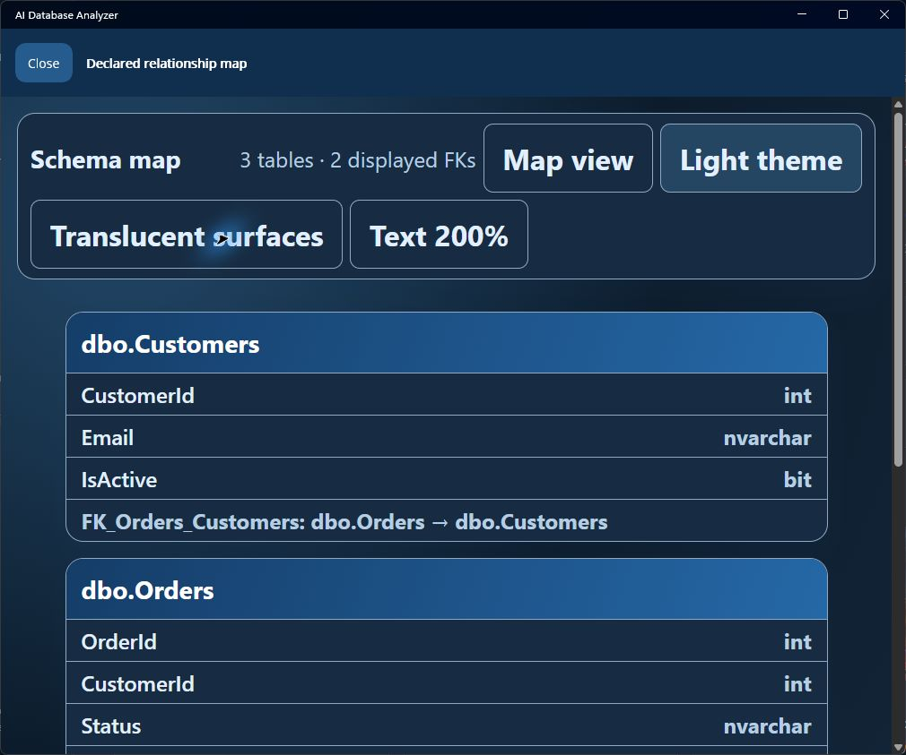
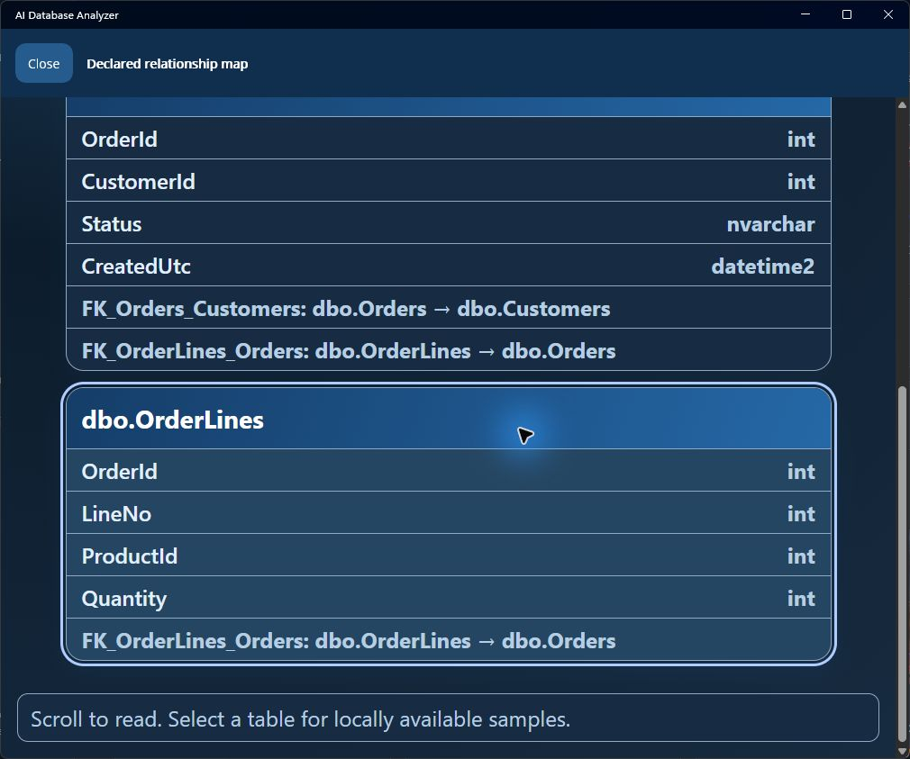

# Offline map readability

27 September 2026. The production `SchemaDiagramHtml.Create` output was exercised in Chromium and in the Windows MAUI WebView. This is a targeted development check, not a WCAG conformance certificate.

The toolbar offers light/dark palettes, opaque surfaces (the default), optional 94% alpha surfaces, and actual text sizing at 100/150/200%. There is no backdrop blur. Controls have a minimum 44-pixel size and wrap. No custom animation or hover movement runs. Preferences last for this map instance and are not saved to account or app settings.

**List view** removes diagram scaling, lets the whole document scroll normally, wraps long table/column/type names, and includes declared foreign keys as readable text on their endpoint cards. Its toolbar scrolls with the document so enlarged controls cannot cover table content. **Map view** retains pan/zoom and declared relationship lines; fitted diagrams may shrink text, so select List view when reading it. Arrow keys pan 36 pixels, Shift moves 108, and Home fits. Tab focus brings a card into the visible map area; Enter activates its existing local sample command.

| Actual check | Observed result |
| --- | --- |
| Chromium, production demo output | Three tables and two relationships; ArrowRight moved the diagram 36 pixels and Home fitted it |
| Chromium, nine-table stress fixture | Eight relationships; distinct `[a.b].[c]` and `[a].[b.c]` identities retained; long names and empty columns readable |
| Chromium at 320 pixels, dark List view, 200% text | Root font 32px, column/type font 24px, scene transform `none`; document width and scroll width both 305px; all sixteen endpoint relationship labels present |
| Chromium map at 1280×720, five zoom-in actions | Keyboard focus on the last card brought it below the toolbar and above the hint; this was not the maximum zoom |
| Actual Windows application, default 1009×841 | Light and dark List view, 100→150→200% controls worked; FK text remained present |
| Actual Windows WebView, dark List view, 200% | Tab from Orders to OrderLines scrolled the final card into view with its focus outline, all four columns and FK text visible |
| Local table command | Selecting synthetic Orders displayed `No sample data found for dbo.Orders.` locally; no model was invoked |
| Close | Returned to the existing schema preview and export controls |





The palette and alpha-composited contrast calculations are recorded alongside the local validation evidence. They cover normal/secondary text, white card titles, control borders, focus and relationship strokes across the map background/hover/surface colors. The MAUI entry placeholder was corrected for its actual fixed light background. The rest of the application's fixed light styling is still a separate improvement.

Limits: no real browser zoom, screen reader, high-contrast OS theme, OS DPI matrix, native map at every zoom level, touch device, non-Windows target or fresh-machine installation was tested here. A three-table demo and synthetic stress fixture do not establish usability on a large production schema. The underlying 29-test suite includes three actual local SQL Server cases; no additional cosmetic mirror tests were added.

To inspect exactly the production HTML without running MAUI:

```powershell
dotnet run --project tools/SchemaMapPreview -- path/to/owned-schema.json path/to/new-preview.html
```

The helper links the production class and refuses to overwrite an existing preview. Use synthetic or explicitly approved metadata; do not share a live schema export publicly.
