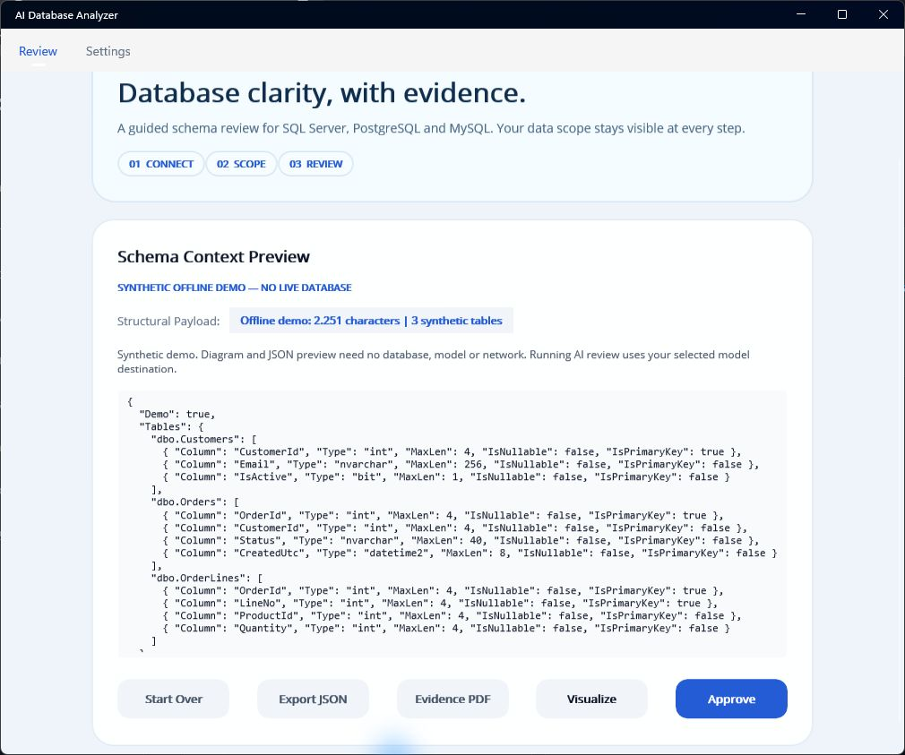
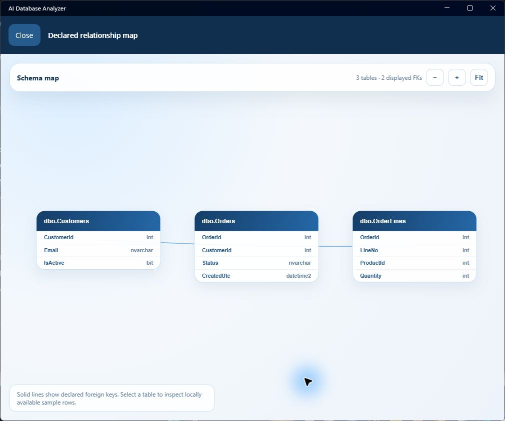
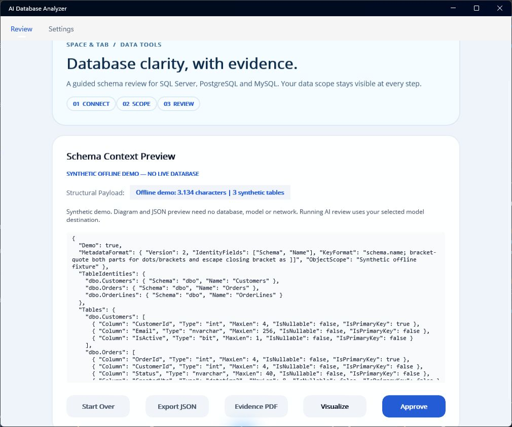

# Local Windows validation

27 September 2026, Windows 11, .NET 9 MAUI Windows x64. These checks use the packaged synthetic demo, not a user's database. They are development evidence, not a fresh-machine installation certificate.

| Path | Observed result |
| --- | --- |
| Main window | Identifiable AI Database Analyzer title; synthetic demo available without credentials |
| Try the offline demo | Three tables and two foreign keys; no database or model required |
| Export JSON | Parsed output equals the packaged demo; three tables and no sample rows |
| Visualize | Real WebView rendered all three cards with every column and relationship; no CDN dependency |
| Evidence PDF | Native command created a five-page PDF with the source-field manifest and sample-free schema JSON |
| Independent PDF inspection | All five pages rendered and inspected; readable text, page numbers, no clipped or overlapping content |
| SQL Server tests | 29 passed, zero skipped, with `AIDB_TEST_SQLSERVER` set to `.\SQLEXPRESS` |

The prior map applied the global 34-pixel button height to table cards and clipped columns. Cards now have automatic height. The screenshots below were captured from the actual application using synthetic metadata.

The Windows Release build passed with existing nullable, XAML and MVVM analyzer warnings (272 in the clean 48ef8fc build); warnings were not disabled. The Evidence PDF identifies itself as local metadata, with no model request or sample rows. It does not assert a workload defect, permission finding or compliance result. Optional local JSON exports can contain samples when explicitly selected; the demo has none.

No Ollama service was available for a real model run. Gemini requests, PostgreSQL/MySQL servers, production certificates, full keyboard/screen-reader/scaling coverage, non-Windows builds and fresh-machine installation are separate checks. A successful local demo is not evidence for those paths.

The delimiter-safe format-2 build retained three ordinary dbo labels and added raw Schema/Name identity fields. Its native JSON equals the demo; all five PDF pages were rendered and inspected. In the default 1009×841 window, a nested star-sized Grid had prevented the outer page from measuring its full height. The ScrollView now directly measures the stack: wheel scrolling exposes Export JSON/Evidence PDF without maximizing, and the native JSON export matched the same snapshot.

